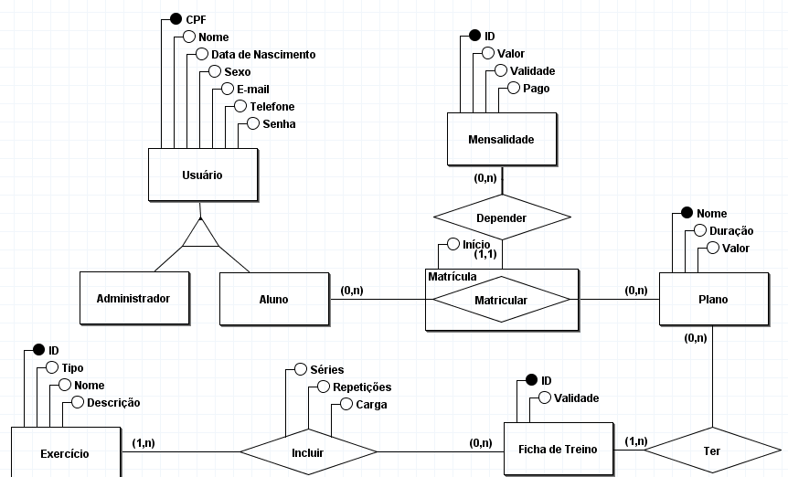

# Projeto-Final-Y2
Projeto Final do segundo ano no Curso Técnico Integrado ao Médio de Desenvolvimento de Sistemas para *Banco de Dados*, *Programação Orientada a Objetos* e *Desenvolvimento Web* seguindo o documento [Regras e Temas](https://docs.google.com/document/d/1ekSitklC8l7GNgB57n81PTTlCHT80YWE_9BawfEOq7A/edit?usp=sharing), sendo o nosso tema o oitavo (8º) – **Gestão de Academia**.

## Integrantes
| Nome | E-mail | Diário |
| --- | --- | --- |
| [Dafny Heloa da Silva Lins](@DafnyLins06) | <dhsl1@aluno.ifal.edu.br> | |
| [Derick Davi Veríssimo Marinho](@Redestroyer) | <ddvm1@aluno.ifal.edu.br> | |
| [Hiago Alves Barboza](@hab2-cloud) | <hab2@aluno.ifal.edu.br> | |

## Diagrama de Banco

**A SER FEITO**: Criar o diagrama lógico e pôr a imagem aqui
