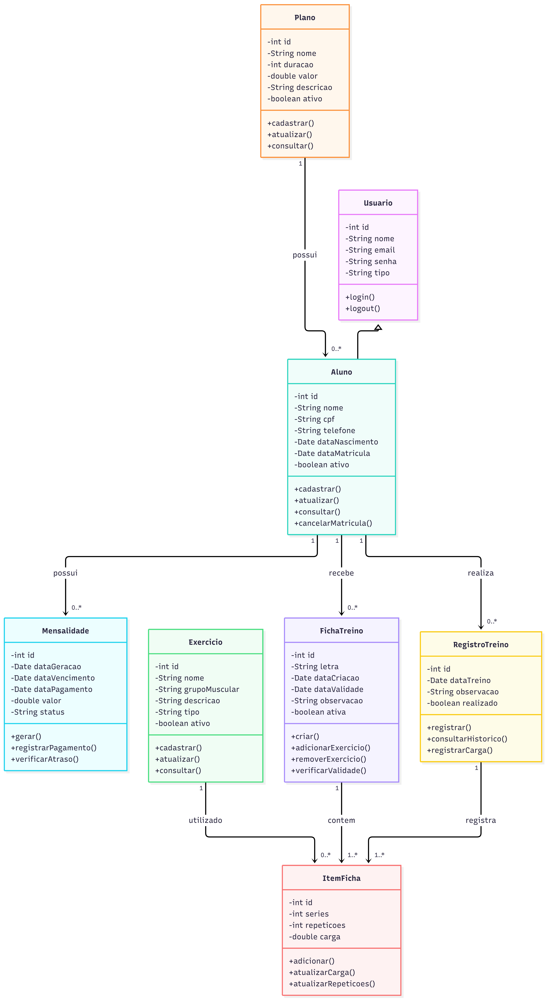

# Projeto-Final-Y2
Projeto Final do segundo ano no Curso Técnico Integrado ao Médio de Desenvolvimento de Sistemas para *Banco de Dados*, *Programação Orientada a Objetos* e *Desenvolvimento Web* seguindo o documento [Regras e Temas](https://docs.google.com/document/d/1ekSitklC8l7GNgB57n81PTTlCHT80YWE_9BawfEOq7A/edit?usp=sharing), sendo o nosso tema o oitavo (8º) – **Gestão de Academia**.

## Integrantes
| Nome | E-mail | Diário |
| --- | --- | --- |
| [Dafny Heloa da Silva Lins][@DafnyLins06] | <dhsl1@aluno.ifal.edu.br> | [`dafny.md`][] |
| [Derick Davi Veríssimo Marinho][@Redestroyer] | <ddvm1@aluno.ifal.edu.br> | [`derick.md`][] |
| [Hiago Alves Barboza][@hab2-cloud] | <hab2@aluno.ifal.edu.br> | [`hiago.md`][] |

## Ferramentas a empregar
* [Express][]: motor de servidor HTTP simples e minimalista.
* [TailwindCSS][]: motor de estilização CSS flexível, configurável, abrangente e visualmente moderno.
* [PugJS][]: motor de moldagem HTML capaz de reduzir repetição de código e verter dinamicamente com diferentes valores.

## Diagrama de Banco
  
**A SER FEITO**: Criar o diagrama lógico e pôr a imagem aqui

## Diagrama de Classe

[@DafnyLins06]: https://github.com/DafnyLins06
[`dafny.md`]: /diario/dafny.md
[@Redestroyer]: https://github.com/Redestroyer
[`derick.md`]: /diario/derick.md
[@hab2-cloud]: https://github.com/hab2-cloud
[`hiago.md`]: /diario/hiago.md

[Express]: https://expressjs.com
[TailwindCSS]: https://tailwindcss.com
[PugJS]: https://pugjs.org
